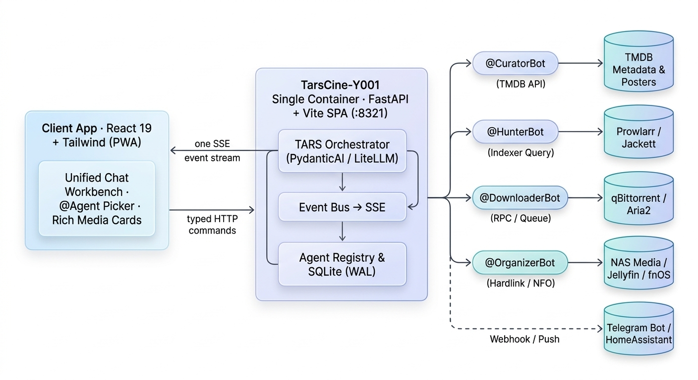

<div align="center">

# 🎬 TarsCine-Y001

**Your Multi-Agent AI Cinema Concierge for NAS**  
*灵感源自《星际穿越》TARS 机器人 × Apple Liquid Glass 空间视觉美学*

[](LICENSE)
[](#-nas-docker-快速部署)
[](#-技术栈与项目结构)
[](#-核心特性)

[项目简介](#-项目简介) • [系统架构](#-系统架构与工作流) • [核心特性](#-核心特性) • [快速部署](#-nas-docker-快速部署) • [开发路线](#-开发路线图)

</div>

---

## ✨ 项目简介

**TarsCine-Y001** 是一款专为私人 NAS 打造的**跨端多智能体（Multi-Agent）影视自动化管家**。

项目深度融合了 **OpenManus** 的多智能体协作机制与 **Apple Liquid Glass** 空间视觉设计。您只需在一个统一的对话工作台中下达自然语言指令，即可唤醒内置的四大专职 AI 机器人（支持自定义扩展），全自动完成 **“意图推荐 → 全网搜源 → 调度下载 → 硬链接刮削入库”** 的观影闭环。

---

## 🏗️ 系统架构与工作流

系统采用**前后端合并单容器交付**架构，底层通过 **SSE（Server-Sent Events）** 实时向前端流式推送多智能体的思考与协作状态。

### 📊 工作逻辑与协作时序图
> ****  


### 🧩 核心分层与智能体矩阵

* **跨端交互层**：基于 Apple Liquid Glass UI 打造的跨端响应式界面与 PWA 统一对话工作台。
* **单容器后端**：`FastAPI` + `Vite SPA` 单端口聚合，内置 **TARS 主控调度器**、**Agent Registry 矩阵**及 **SQLite (WAL)** 轻量级高并发状态库。
* **专职智能体矩阵**：

| 智能体角色 | 核心职责 | 对接生态 / 协议 |
| :--- | :--- | :--- |
| **`@CuratorBot`** *(片单推荐官)* | 理解模糊观影意图、解析片名与元数据 | TMDB API |
| **`@HunterBot`** *(资源猎手)* | 多站点聚合检索、洗版策略匹配与做种评估 | Prowlarr / Jackett |
| **`@DownloaderBot`** *(下载调度员)* | 推送种子/磁力任务、监控下载进度与异常重试 | qBittorrent / Aria2 |
| **`@OrganizerBot`** *(刮削归档管家)* | 自动化重命名、秒级硬链接、触发媒体库刷新 | 极空间 / 飞牛 / Jellyfin |

---

## 🤖 核心特性

- **🧠 四大内置机器人与自定义扩展**  
  支持在可视化面板中**零代码新建专属 `@自定义机器人`**；同时面向开发者开放 `plugins/` 目录，仅需通过 `@register_agent` 装饰器即可快速挂载新技能。
- **🧊 Apple Liquid Glass 空间视觉体验**  
  采用深邃流光暗色背景、多层毛玻璃折射（`backdrop-blur`）、1px 细腻高光边缘与微交互动效，并贴心内置低功耗与弱性能设备降级模式。
- **📱 全平台覆盖与原生级 PWA**  
  前后端单端口极简交付，针对移动端深度适配 iOS / Android PWA 特性，支持“添加到主屏幕”获得沉浸式全屏原生 App 体验。
- **🔔 灵活的消息触达**  
  内置通知抽象层，预留 Telegram Bot 推送支持，影视下载与入库状态随时掌控。

---

## 🛠️ 技术栈与项目结构

### 技术栈一览
* **前端工程**：`Vite 6` · `React 19` · `TypeScript` · `TanStack Router` · `Zustand` · `Tailwind CSS`
* **后端引擎**：`Python 3.11+` · `FastAPI` · `PydanticAI / LiteLLM` · `SQLite (WAL)` · `APScheduler` · `SSE`
* **容器构建**：`Docker Multi-stage Build`（原生支持 `linux/amd64` 与 `linux/arm64` 双架构）

### 目录结构
```text
tarscine-y001/
├── AGENTS.md                 # 跨 AI 编程工具统一架构与设计契约 (v2.1)
├── Dockerfile                # 前后端合并多阶段构建镜像文件
├── docker-compose.yml        # NAS Docker 一键部署模板
├── docs/                     # 界面展示截图、工作逻辑图与文档目录
├── frontend/                 # Vite + React 前端与 Liquid Glass 组件库
└── backend/                  # FastAPI 多智能体编排与外部服务适配器
```

---

## 🚀 NAS Docker 快速部署

> ⚠️ **硬链接目录规范提示**  
> 为确保 `@OrganizerBot` 能够实现**零磁盘额外占用、秒级完成硬链接**，请务必保证宿主机上的**下载目录**与**媒体库目录**位于同一个父级目录下（例如 `/Media/downloads` 与 `/Media/movies`），并将该父级目录统一映射为容器内的 `/media`。

### 1. 创建编排文件
在您的 NAS 中新建项目目录，创建并编辑 `docker-compose.yml`：

```yaml
version: "3.8"

services:
  tarscine-y001:
    image: tarscine-y001:latest
    container_name: tarscine-y001
    restart: unless-stopped
    ports:
      - "8321:8000"
    environment:
      - TZ=Asia/Shanghai
      - PUID=1000
      - PGID=1000
    volumes:
      - ./config:/config                 # 存放配置文件与 SQLite 数据库
      - /path/to/your/nas/Media:/media   # 统一媒体根目录（兼顾下载与影音库）
```

### 2. 启动与访问
1. 在 `docker-compose.yml` 所在目录执行以下命令启动服务：
   ```bash
   docker-compose up -d
   ```
2. **桌面端访问**：浏览器打开 `http://<你的NAS_IP>:8321`。
3. **移动端体验**：使用 Safari（iOS）或 Chrome（Android）访问上述地址，点击浏览器菜单中的**“添加到主屏幕”**即可开启 PWA 全屏模式。

---

## 🗺️ 开发路线图

本项目按照四个核心里程碑（Milestone）稳步演进：

- [x] **Milestone 1**：基础前后端单容器脚手架与 SQLite (WAL) 数据层搭建
- [x] **Milestone 2**：Apple Liquid Glass 响应式 UI 组件库与移动端 PWA 适配
- [ ] **Milestone 3**：TARS 主控调度器、LiteLLM 多模型路由与 SSE 流式协作引擎
- [ ] **Milestone 4**：可视化 Agent 编排设置面板、插件热加载与通知生态完善

---

## 📄 开源协议

本项目基于 [MIT License](LICENSE) 协议开源，欢迎提交 Issue 或 Pull Request 共同完善您的私人 AI 观影管家！
