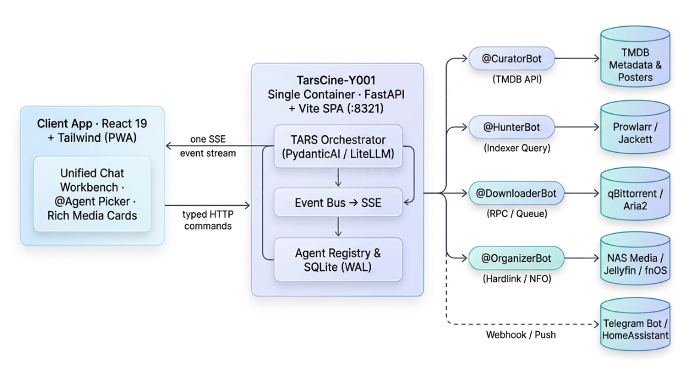

<div align="center">

# 🎬 TarsCine-Y001

**Your Multi-Agent AI Cinema Concierge for NAS**  
*灵感源自《星际穿越》TARS 机器人 × Apple Liquid Glass 空间视觉美学*

`📄 MIT License` · `🐳 Docker Multi-Stage` · `💻 amd64 | arm64` · `📱 PWA Ready` · `☁️ Cloud Sandbox Ready`

[项目简介](#-项目简介) • [系统架构](#-系统架构与工作流) • [核心特性](#-核心特性) • [快速部署](#-nas-docker-快速部署) • [开发路线](#-开发路线图)

</div>

---

## ✨ 项目简介

**TarsCine-Y001** 是一款专为私人 NAS（及云端轻量化测试）打造的**跨端多智能体（Multi-Agent）影视自动化管家**。

项目深度融合了 **OpenManus** 的多智能体协作机制与 **Apple Liquid Glass** 空间视觉设计。您只需在一个统一的对话工作台中通过**自然语言**或**发送截图/海报**下达指令，即可唤醒内置的专职 AI 机器人矩阵，全自动完成 **“多模态识图/偏好推荐 → 聚合与破壁搜源 → 防爆盘调度下载 → 硬链接刮削与双语字幕生成”** 的完整观影闭环。

---

## 🏗️ 系统架构与工作流

系统采用**前后端合并单容器交付**架构，底层通过 **SSE（Server-Sent Events）** 实时向前端流式推送多智能体的思考与协作状态。

### 📊 工作逻辑与协作时序图
****  

### 🧩 核心分层与智能体矩阵

* **跨端交互层**：基于 Apple Liquid Glass UI 打造的跨端响应式界面，内置**四步首启向导**、**空会话快捷指令**与移动端 PWA 原生级体验。
* **单容器轻量化后端**：`FastAPI` + `Vite SPA` 单端口聚合，内置 **TARS 主控调度器**、**Agent Registry 动态插件中心**、**APScheduler 持久化队列**及 **SQLite (WAL)** 高并发状态库。
* **全能智能体矩阵（内置核心 + 二期高玩扩展）**：

| 智能体角色 | 核心职责 | 对接生态 / 技术路线 |
| :--- | :--- | :--- |
| **`@CuratorBot`** *(片单与推荐官)* | 多模态识图找片、今日/本周/本月偏好推荐、本地库存盲盒抽片 | Vision LLM / TMDB API / Jellyfin |
| **`@HunterBot`** *(资源猎手)* | 多站点聚合检索、洗版策略匹配与做种质量打分 | Prowlarr / Jackett |
| **`@DeepHunterBot`** *(冷门破壁手)* | 针对无 API 小众站点进行轻量网页正文清洗与 LLM 链接提取 | `httpx` / External Sidecar 预留 |
| **`@DownloaderBot`** *(下载调度员)* | 推送种子/磁力/直链、监控实时进度、支持云端沙盒模拟演示 | qBittorrent / Aria2 / Mock Sandbox |
| **`@OrganizerBot`** *(刮削归档管家)* | 电影/剧集分季重命名、同分区检测与秒级硬链接、媒体库刷新 | 极空间 / 飞牛 fnOS / Jellyfin |
| **`@SubtitleBot`** *(AI 双语字幕师)* | 轻量化音轨提取与外部 Whisper + LLM 上下文意译生成双语字幕 | External Whisper API + `ffmpeg` |
| **`@WatcherBot`** *(追剧洗版官)* | 定时巡检连载剧集与高画质洗版，内置 NAS 磁盘剩余空间熔断锁 | APScheduler + Disk Guard |
| **`@WrappedBot`** *(年度观影总结官)* | 聚合年度/阶段观影数据生成专属影迷称号、长图海报与盲盒祝福签 | Dual-Source Stats + `html-to-image` |

---

## 🤖 核心特性

- **🖼️ 多模态以图搜片与智能推荐矩阵**  
  支持直接拖拽或 `Ctrl+V` 粘贴电影截图、无字海报识别片名；结合您的观影口味画像提供**今日 / 本周 / 本月精准推荐**，并内置**“今晚看啥”本地未看库存抽盲盒**，彻底告别片荒。
- **🛡️ NAS 工程级防呆与安全红线**  
  内置**四步首启初始化向导**与 `st_dev` **硬链接同分区实时自检**；自动榜单巡航与追剧洗版配备**磁盘剩余空间熔断保护锁**，严防夜间自动下载撑爆硬盘；支持可选全局 PIN 码锁与敏感密钥脱敏。
- **🎁 沉浸式观影年度报告 & 盲盒祝福彩蛋**  
  支持双源数据降级统计（无 Jellyfin 亦可基于本地入库记录生成），一键导出高清液态玻璃分享长图，内嵌可翻转的**“年度观影盲盒祝福签”**互动彩蛋。
- **🪶 极度轻量化，兼容低功耗 NAS 与云服务器沙盒**  
  严格剥离重型本地模型与无头浏览器依赖，单镜像轻量运行；内置 **Cloud Sandbox（云端沙盒演示模式）**，即使在无下载器、无大硬盘的云服务器上也能 100% 跑通全链路模拟体验。
- **🧊 Apple Liquid Glass 空间视觉与原生 PWA**  
  深邃流光背景、多层毛玻璃折射与弹簧微交互，自带低功耗性能降级开关；支持 iOS / Android “添加到主屏幕”全屏运行。

---

## 🛠️ 技术栈与项目结构

### 技术栈一览
* **前端工程**：`Vite 6` · `React 19` · `TypeScript` · `TanStack Router` · `Zustand` · `Tailwind CSS` · `Framer Motion`
* **后端引擎**：`Python 3.11+` · `FastAPI` · `PydanticAI / LiteLLM` · `SQLite (WAL)` · `APScheduler` · `SSE`
* **容器构建**：`Docker Multi-stage Build`（原生支持 `linux/amd64` 与 `linux/arm64` 双架构，内置 `PUID/PGID` 权限映射）

### 目录结构
```text
tarscine-y001/
├── AGENTS.md                 # 核心架构与设计契约 (v2.2)
├── AGENTS_ADDENDUM.md        # 二期高玩功能与轻量化增量开发总纲 (v2.6-Delta)
├── Dockerfile                # 前后端合并多阶段构建镜像文件
├── entrypoint.sh             # NAS PUID/PGID 权限动态映射脚本
├── docker-compose.yml        # NAS / 云服务器 Docker 一键部署模板
├── docs/                     # 界面展示截图、工作逻辑图与文档目录
├── frontend/                 # Vite + React 前端、Liquid Glass 组件与首启向导
└── backend/                  # FastAPI 多智能体编排、插件系统与适配器
```

---

## 🚀 快速部署 (NAS & 云端测试)

> ⚠️ **NAS 硬链接目录规范提示**  
> 为确保 `@OrganizerBot` 能够实现**零磁盘额外占用、秒级完成硬链接**，请务必保证宿主机上的**下载目录**与**媒体库目录**位于同一个父级目录下（例如 `/Media/downloads` 与 `/Media/movies`），并将该父级目录统一映射为容器内的 `/media`。

### 1. 创建编排文件
在您的 NAS 或测试服务器中新建项目目录，创建并编辑 `docker-compose.yml`：

```yaml
version: "3.8"

services:
  tarscine-y001:
    image: tarscine-y001:latest
    container_name: tarscine-y001
    restart: unless-stopped
    ports:
      - "8321:8000"
    environment:
      - TZ=Asia/Shanghai
      - PUID=1000
      - PGID=1000
    volumes:
      - ./config:/config                 # 存放配置文件、上传截图与 SQLite 数据库
      - /path/to/your/nas/Media:/media   # 统一媒体根目录（云端测试可挂载任意空目录）
```

### 2. 启动与初始化引导
1. 在 `docker-compose.yml` 所在目录执行以下命令启动服务：
   ```bash
   docker-compose up -d
   ```
2. **首次访问与向导**：浏览器打开 `http://<你的IP>:8321`，系统将自动弹出**四步液态玻璃初始化向导**（支持一键测试 LLM/TMDB 连通性及 NAS 路径硬链接检测；若在云服务器测试，可启用模拟沙盒模式直接体验完整流程）。
3. **移动端体验**：使用 Safari（iOS）或 Chrome（Android）访问上述地址，点击浏览器菜单中的**“添加到主屏幕”**即可开启 PWA 全屏模式。

---

## 🗺️ 开发路线图

- [x] **Milestone 1**：基础前后端单容器脚手架与 SQLite (WAL) 数据层搭建
- [x] **Milestone 2**：Apple Liquid Glass 响应式 UI 组件库与移动端 PWA 适配
- [x] **Milestone 3**：TARS 主控调度器、四大核心机器人全链路跑通
- [x] **Milestone 4**：设置与运维中心、单容器多架构 Docker 交付
- [ ] **Phase 2 (Delta 增量演进)**：首启引导向导、多模态以图搜片、智能推荐矩阵（含防爆盘榜单巡航）、年度观影报告长图与轻量化 AI 双语字幕

---

## 📄 开源协议

本项目基于 [MIT License](LICENSE) 协议开源，欢迎提交 Issue 或 Pull Request 共同完善您的私人 AI 观影管家！
